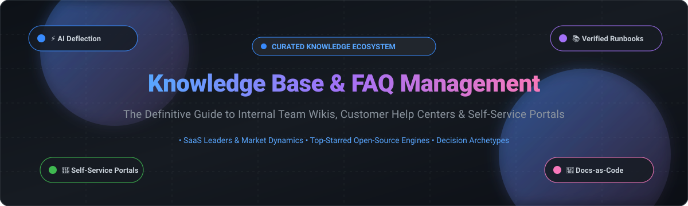
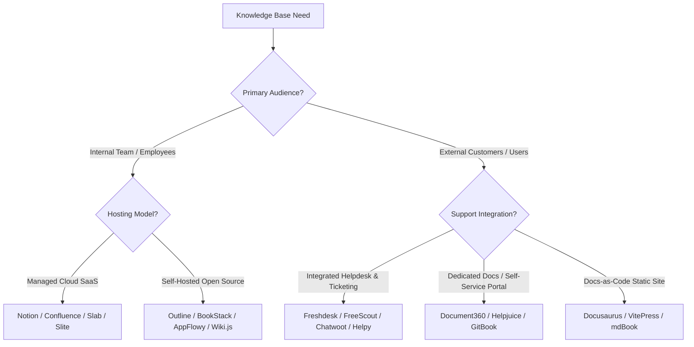

# 🧠 Awesome Knowledge Base &amp; FAQ Management 📚

  
  
  
  
  
  
  

**A curated index of top-tier Knowledge Base (KB) platforms, FAQ management suites, customer self-service portals, and open-source wiki engines.**

*Discover enterprise-ready SaaS platforms and high-performance open-source self-hosted solutions to streamline documentation, deflect repetitive support tickets, and scale institutional knowledge.*

---

## 📑 Table of Contents

- [📊 Sector Overview & Market Dynamics](#-sector-overview--market-dynamics)
- [☁️ SaaS & Hosted Platforms](#️-saas--hosted-platforms)
- [💻 Open-Source GitHub Projects](#-open-source-github-projects)
- [🏗️ Feature Comparison & Architectural Archetypes](#️-feature-comparison--architectural-archetypes)
- [⭐ Star History](#-star-history)
- [💖 Support & Community](#-support--community)
- [🤝 How to Contribute](#-how-to-contribute)
- [📜 Disclaimer & License](#-disclaimer--license)

---

## 📊 Sector Overview & Market Dynamics

The global Knowledge Management Software (KMS) market is estimated at **$13.7B to $23.2B in 2025** and projected to expand to **$16.2B–$26.4B by 2026**, registering a compound annual growth rate (CAGR) between 13.5% and 18.3% driven by generative AI search, automated answer verification, and AI deflection agents.

The sector exhibits **moderate concentration with a bifurcated, highly fragmented application layer**: while enterprise hyperscalers (Microsoft, ServiceNow, Atlassian, Salesforce) anchor core foundational workflows and employee records, specialized point solutions and open-source platforms command significant adoption across developer docs, customer-facing self-service help centers, and privacy-first internal documentation.

---

## ☁️ SaaS & Hosted Platforms

*Commercial knowledge management platforms sorted descending by company size (market valuation / annual revenue).*

| Platform | Company Size (Valuation / Revenue) | Starting Paid Price | Free Tier Limits / Free Trial | Key Capabilities & Best For |
|:---|:---|:---|:---|:---|
| **[Confluence](https://www.atlassian.com/software/confluence)** (Atlassian) | **~$48B Market Cap** / ~$4.4B ARR | **$6.05 / user / month** (billed annually) or $7.15/user (monthly) | **Free forever plan**: Up to 10 users, 2 GB total storage, unlimited spaces & pages (no page permissions or audit logs) | Enterprise workspace documentation, cross-functional project wikis, deep Jira integration, and team runbooks. |
| **[Notion](https://www.notion.so/)** | **~$10B Valuation** / ~$300M+ ARR | **$10 / user / month** (billed annually at $8/mo) | **Free forever plan**: Unlimited pages/blocks for 1 user, 5 MB file upload limit, 7-day version history, 10 guests (team workspaces capped at 1,000 shared blocks) | Highly modular workspace combining databases, internal knowledge bases, team FAQs, and project wikis with AI authoring. |
| **[Freshdesk Knowledge Base](https://www.freshworks.com/freshdesk/)** (Freshworks) | **~$4.5B Market Cap** / ~$700M+ ARR | **$15 / agent / month** (billed annually at $15/mo, Growth tier) | **Free tier / program**: Free for up to 2 agents for 6 months (includes public KB & self-service ticketing portal), plus 14-day free trial on paid tiers | Customer support help center, public FAQ portal, and ticket deflection tightly integrated with omnichannel ticketing. |
| **[Guru](https://www.getguru.com/)** | **~$220M Valuation** / ~$63M ARR | **$15 / user / month** (billed annually; customized enterprise plans available) | **30-day free trial** with full feature access (no permanent free tier; legacy starter plan deprecated) | AI-powered verified answers, in-context browser extension capture, and contextual knowledge delivery for support/sales reps. |
| **[Document360](https://document360.com/)** (Kovai.co) | **~$100M Valuation** (Parent Kovai.co) / ~$10M+ ARR | **$149 / project / month** (billed annually, standard tier) | **14-day free trial** with full platform evaluation (no credit card required; no permanent free tier) | Specialized technical documentation, multi-version customer-facing help centers, private knowledge portals, and Eddy AI search. |
| **[Bloomfire](https://bloomfire.com/)** | **~$50M–$100M Est. Valuation** / ~$11M ARR | **~$1,000 / month** (billed annually, enterprise quote model) | **Demo / Guided trial on request** (no self-serve free tier or public trial) | Enterprise knowledge orchestration, searchable multimedia repositories, AI Q&A deflection, and market research centralization. |
| **[Slab](https://slab.com/)** | **~$20M–$30M Est. Valuation** / ~$7.2M ARR | **$6.67 / user / month** (billed annually) or $8/user (monthly) | **Free forever plan**: Up to 10 users, unlimited posts & topics, unified search, 90-day version history, 10 MB attachment cap | Clean, modern internal wiki designed for fast search, technical teams, and friction-free cross-app content sync. |
| **[Slite](https://slite.com/)** | **~$15M+ VC Funding** / ~$5.5M ARR | **$10 / user / month** (billed annually) or $12/user (monthly) | **14-day free trial** with full access to standard and AI capabilities (no credit card required; no permanent free tier) | AI-first collaborative company handbook and team knowledge management with automated content review cadences. |
| **[Helpjuice](https://helpjuice.com/)** | **Bootstrapped** / ~$4.5M ARR | **$249 / month** (Starter plan, up to 30 users) | **14-day free trial** with full feature access and unlimited public viewers (extendable by 7 days upon adding billing details) | Dedicated customer support knowledge base and FAQ platform featuring tailored themes, instant search, and intelligent analytics. |
| **[GitBook](https://www.gitbook.com/)** | **Bootstrapped / Seed** / ~$3.9M ARR | **$65 / site / month + $12 / user / month** (billed annually) | **Free forever plan**: 1 user, unlimited public doc spaces on gitbook.io subdomain, Git sync (custom domain requires Essential tier) | Developer documentation, API reference guides, docs-as-code GitHub/GitLab synchronization, and public product manuals. |

---

## 💻 Open-Source GitHub Projects

*Self-hosted knowledge base platforms, open wikis, customer support FAQ portals, and docs-as-code engines. Sorted descending by GitHub_Stars_Count.*

| Project | GitHub_Stars | Tech Stack | License | Description & Use Case |
|:---|:---:|:---:|:---:|:---|
| **[AppFlowy](https://github.com/AppFlowy-IO/AppFlowy)** |  | Flutter / Rust | AGPL-3.0 | Open-source alternative to Notion. Privacy-first, local-first collaborative workspace for building team wikis, knowledge bases, and task databases. |
| **[Docusaurus](https://github.com/facebook/docusaurus)** |  | React / Node.js | MIT | Leading static site generator built for documentation websites, versioned product FAQs, interactive code blocks, and localized help centers. |
| **[Outline](https://github.com/outline/outline)** |  | Node.js / React | BSL-1.1 / Open | Fast, beautiful, and collaborative team knowledge base. Features Markdown support, granular permissions, Slack integration, and self-hosted deployment. |
| **[Chatwoot](https://github.com/chatwoot/chatwoot)** |  | Ruby on Rails / Vue | AGPL-3.0 | Customer engagement suite with built-in public Help Center, multi-language FAQ portal, and live-chat customer support deflection. |
| **[Wiki.js](https://github.com/requarks/wiki)** |  | Node.js / Vue | AGPL-3.0 | Extensible modern open-source wiki with Markdown/WYSIWYG editors, granular access control, multiple storage backends, and multi-cloud sync. |
| **[Docmost](https://github.com/docmost/docmost)** |  | Node.js / NestJS / React | AGPL-3.0 | Open-source collaborative wiki and documentation software featuring real-time multiplayer editing, nested spaces, and rich document formatting. |
| **[mdBook](https://github.com/rust-lang/mdBook)** |  | Rust | MPL-2.0 | Fast, lightweight CLI utility that compiles Markdown files into structured, searchable online documentation books and developer FAQ guides. |
| **[BookStack](https://github.com/BookStackApp/BookStack)** |  | PHP / Laravel | MIT | Opinionated documentation engine organized logically into Books, Chapters, and Pages. Perfect for internal company SOPs, support manuals, and FAQ sites. |
| **[VitePress](https://github.com/vuejs/vitepress)** |  | Vue / Vite | MIT | Vite & Vue powered static site documentation generator. Offers lightning-fast page loading and minimal configuration for technical FAQ portals. |
| **[Gollum](https://github.com/gollum/gollum)** |  | Ruby / Git | MIT | Git-powered lightweight wiki engine backing GitHub Wikis. Allows version-controlled Markdown/AsciiDoc editing locally or via an intuitive web UI. |
| **[HedgeDoc](https://github.com/hedgedoc/hedgedoc)** |  | Node.js / TypeScript | AGPL-3.0 | Real-time collaborative Markdown editor for drafting team runbooks, collaborative support FAQs, meeting notes, and technical drafts. |
| **[MediaWiki](https://github.com/wikimedia/mediawiki)** |  | PHP / MariaDB | GPL-2.0 | Battle-tested, enterprise-grade wiki platform powering Wikipedia. Handles millions of articles, comprehensive edit histories, and extensive extension ecosystems. |
| **[DokuWiki](https://github.com/dokuwiki/dokuwiki)** |  | PHP | GPL-2.0 | Simple-to-use, standards-compliant wiki requiring no database backend (stores plain text files). Excellent for lightweight, zero-maintenance knowledge hubs. |
| **[FreeScout](https://github.com/freescout-helpdesk/freescout)** |  | PHP / Laravel | AGPL-3.0 | Self-hosted help desk and shared inbox solution offering an integrated knowledge base module to deploy public self-service FAQs and help articles. |
| **[TriliumNext Notes](https://github.com/TriliumNext/Notes)** |  | JavaScript / Node.js | AGPL-3.0 | Hierarchical personal and team knowledge base application designed for building deep, interconnected trees of notes, code snippets, and wikis. |
| **[Helpy](https://github.com/helpyio/helpy)** |  | Ruby on Rails | MIT | Mobile-friendly, open-source customer support helpdesk featuring a multi-lingual knowledge base, community support forums, and ticketing. |
| **[django-wiki](https://github.com/django-wiki/django-wiki)** |  | Python / Django | GPL-3.0 | Modular and extensible wiki framework for Django applications with Markdown support, article versioning, plugins, and fine-grained permissions. |
| **[XWiki](https://github.com/xwiki/xwiki-platform)** |  | Java | LGPL-2.1 | Advanced enterprise open-source wiki runtime offering structured data modeling, scripting APIs, document access controls, and custom web applications. |

---

## 🏗️ Feature Comparison & Architectural Archetypes

When selecting a Knowledge Base & FAQ management stack, choose an architecture tailored to your audience and operational workflow:

### 1. 🌐 Customer-Facing Self-Service Portals
* **Key Needs**: Fast indexing, SEO-optimized public URLs, multilingual localization, customer feedback loops (helpful/unhelpful votes), and ticket deflection widgets.
* **Top Choices**: [Document360](https://document360.com/), [Helpjuice](https://helpjuice.com/), [Chatwoot](https://github.com/chatwoot/chatwoot), [BookStack](https://github.com/BookStackApp/BookStack), [FreeScout](https://github.com/freescout-helpdesk/freescout).

### 2. 👥 Internal Engineering Runbooks & Team Wikis
* **Key Needs**: Real-time collaborative editing, enterprise single sign-on (SAML/SSO), Slack/Teams integrations, granular permissions, and verification cycles.
* **Top Choices**: [Confluence](https://www.atlassian.com/software/confluence), [Notion](https://www.notion.so/), [Outline](https://github.com/outline/outline), [Docmost](https://github.com/docmost/docmost), [Slab](https://slab.com/).

### 3. 💻 Docs-as-Code & Developer Knowledge Hubs
* **Key Needs**: Git version control, pull-request review workflows, Markdown/MDX syntax, CI/CD automated deployment, and zero database overhead.
* **Top Choices**: [Docusaurus](https://github.com/facebook/docusaurus), [VitePress](https://github.com/vuejs/vitepress), [mdBook](https://github.com/rust-lang/mdBook), [GitBook](https://www.gitbook.com/).

---

## ⭐ Star History

---

## 💖 Support & Community

Thank you for exploring and utilizing the **Awesome Knowledge Base & FAQ Management** resource list! 🙌

If you find this repository valuable, please consider supporting the project:
- ⭐ **Star this repository** on GitHub to help boost discovery!
- 🍴 **Fork and share** with your teammates, engineering peers, and support leaders.
- ☕ **Buy a coffee or sponsor ongoing maintenance**: [Sponsor Dashboard on GitHub](https://github.com/sponsors/ishandutta2007)

Your support keeps this curated ecosystem up-to-date and thriving!

---

## 🤝 How to Contribute

Contributions are welcome! Help keep this ecosystem guide updated and comprehensive:

1. **Fork the Repository** on GitHub.
2. **Add or Update Entries**: Maintain alphabetical or star-count sorting where appropriate. Provide factual, verified pricing and star links.
3. **Format**: Follow existing table and markdown formatting standards.
4. **Submit a Pull Request**: Provide a concise summary of the addition or change.

---

## 📜 Disclaimer & License

- **Disclaimer**: This list is community-curated for informational purposes. Product pricing, features, and company valuations fluctuate; consult vendor websites for current commercial terms.
- **License**: Released under the [MIT License](LICENSE).
